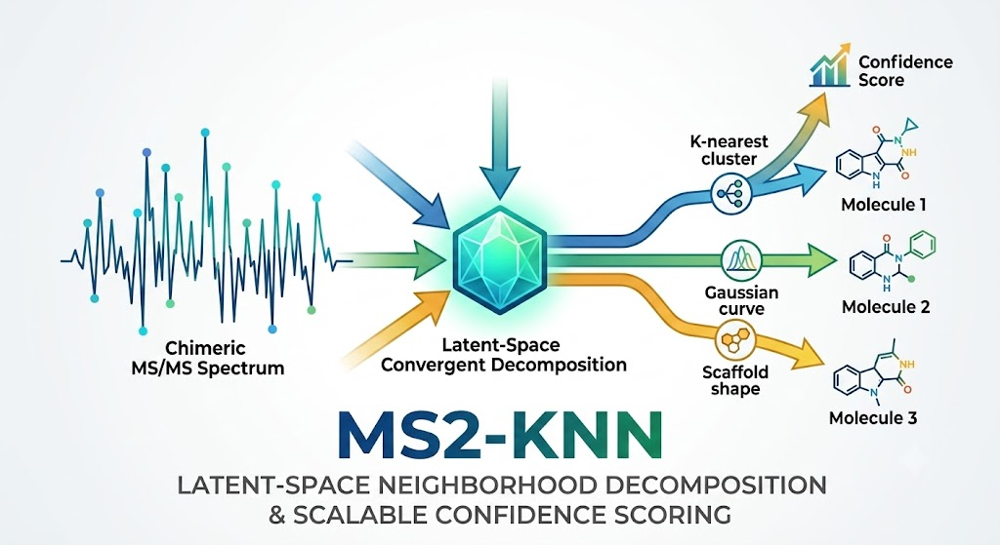

<h1 align="center">
  MS2-KNN
</h1>

<p align="center">
  <em>A Computational Framework Resolving Chimeric Small-Molecule MS/MS Spectra by Latent-Space Neighborhood Decomposition and Scaffold Confidence Scoring</em>
</p>

<p align="center">
  
  
  
  
  
</p>

<p align="center">
  
</p>

## Overview

Chimeric MS/MS spectra arise when coeluting precursor ions are coisolated within the isolation window, so a single spectrum carries fragment ions from multiple molecular species. **MS2-KNN** treats such spectra as composite signals rather than low-quality outliers: query and reference spectra are embedded into a shared latent space, nearest-neighbor candidates are retrieved and adaptively truncated, the number of contributing components is estimated from candidate precursor m/z values, and every candidate group receives an interpretable scaffold-based backbone-confidence score that drives two-level structural pruning.

## Highlights

- **Compound-aware annotation.** The nearest-neighbor set is decomposed into candidate groups, one per putative molecular contributor, instead of returning a single global ranking.
- **Encoder-agnostic.** Works with DreaMS, Spec2Vec, MS2DeepScore, MSBERT, SpecEmb, binned, and neutral-loss binned spectral representations.
- **Interpretable confidence.** Backbone-confidence scoring combines cluster support, scaffold overlap, candidate coverage, and exact scaffold agreement, yielding high, medium, and low confidence labels.
- **Validated end to end.** Benchmarked on synthetic chimeric spectra from MoNA, 88 experimentally acquired mixtures of 43 authentic standards, and 20 real single-herb traditional Chinese medicine extracts, against global similarity search, reverse spectral search, and a CHIMERYS-inspired deconvolution baseline.

## Workflow

1. Encode query and reference-library spectra with the selected spectral encoder.
2. Retrieve Top-K nearest neighbors by embedding cosine similarity.
3. Remove low-similarity background candidates with BIC-selected piecewise-linear adaptive truncation.
4. Estimate the component number from candidate precursor m/z values with Gaussian mixture modeling.
5. Cluster retained candidates into component-associated groups.
6. Compute scaffold and maximum-common-substructure evidence for each group.
7. Score candidates with the backbone confidence and apply two-level pruning, at cluster level and at compound level.
8. Select Top-N candidates from each retained group as compound-resolved annotations.

## Repository structure

```text
python/
  MS2_KNN.py                  core annotation workflow: retrieval, truncation,
                              GMM, clustering, confidence scoring, pruning
  dreams_emb.py               DreaMS embedding wrapper
  spec2vec_emb.py             Spec2Vec embedding wrapper
  ms2deepscore_emb.py         MS2DeepScore embedding wrapper
  msbert_emb.py               MSBERT embedding wrapper
  binned_emb.py               binned-spectrum embedding wrapper
  specEmb_emb.py              SpecEmb embedding wrapper
  cal_embs.py                 embedding computation helpers
  generate_mona_chimera.py    synthetic chimeric spectra from the MoNA library
  pre_emb_chimera_simulating.py  embedding preprocessing for simulated chimeras
  pre_emb_mzml.py             embedding preprocessing for experimental mzML
data/                         per-query benchmark results, see data/README.md
asset/                        figures
```

## Installation

```bash
pip install numpy pandas h5py scikit-learn tqdm torch matplotlib seaborn rdkit
```

Top-K retrieval runs on CUDA when a GPU is available and falls back to blockwise CPU search otherwise.

## Usage

`python/MS2_KNN.py` implements the complete workflow from Top-K retrieval to backbone-confidence pruning. For the manuscript-style structural scoring, set `COMPUTE_SCAFFOLD` and `USE_STRUCTURE_CONFIDENCE` to `True`. The `*_emb.py` wrappers generate embeddings for each supported representation, `generate_mona_chimera.py` builds synthetic chimeric benchmarks from MoNA, and the `pre_emb_*.py` scripts preprocess simulated chimeras and experimental mzML files.

## Data

The [`data/`](data/README.md) folder provides the per-query results of MS2-KNN and the compared methods for the two experimental benchmarks:

- `data/selfcir/`, 88 experimentally acquired standard mixtures queried against a self-built reference library, with full MS2-KNN recommendations, recovery tables, and per-method summaries.
- `data/real_mzml/`, about 7,800 representative queries from 20 single-herb traditional Chinese medicine extracts searched against MoNA, with per-query identifications and herb-level specificity statistics.

The large-scale synthetic benchmark, 10,000 binary and 10,000 ternary chimeric queries, is available from the corresponding author upon request.

## Citation

Wang, Y.; Yin, L.; Hu, M.; et al. MS2-KNN: A Computational Framework Resolving Chimeric Small-Molecule MS/MS Spectra by Latent-Space Neighborhood Decomposition and Scaffold Confidence Scoring. *Analytical Chemistry*, 2026, in press.

<!-- DOI and volume/page range to be added upon publication -->

## License

This project is released under the [MIT License](LICENSE).

## Contact

Xuesong Liu ([liuxuesong@zju.edu.cn](mailto:liuxuesong@zju.edu.cn)) and Tengfei Xu ([tfxu@zju.edu.cn](mailto:tfxu@zju.edu.cn)), School of Pharmacy, Zhejiang University.
